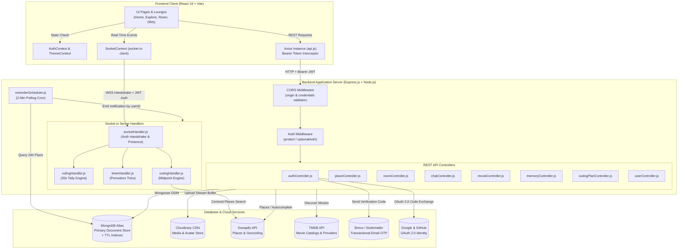
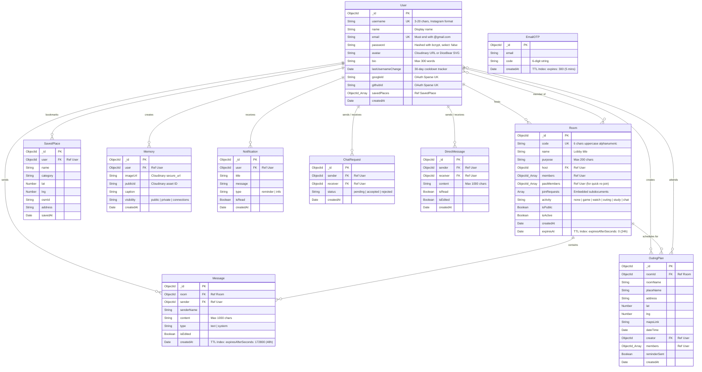
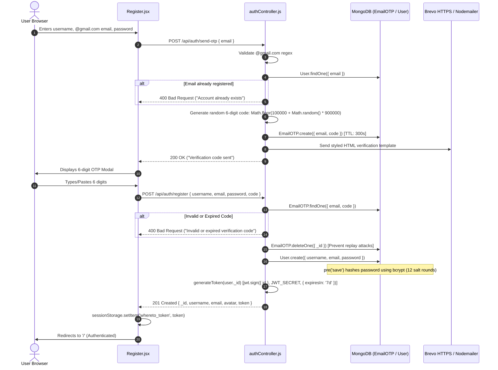
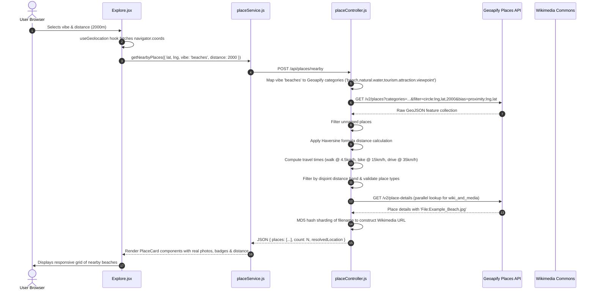
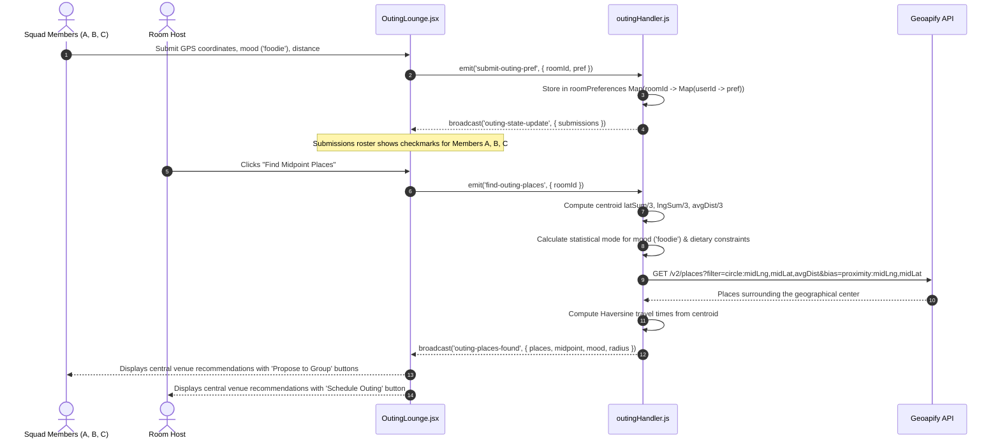
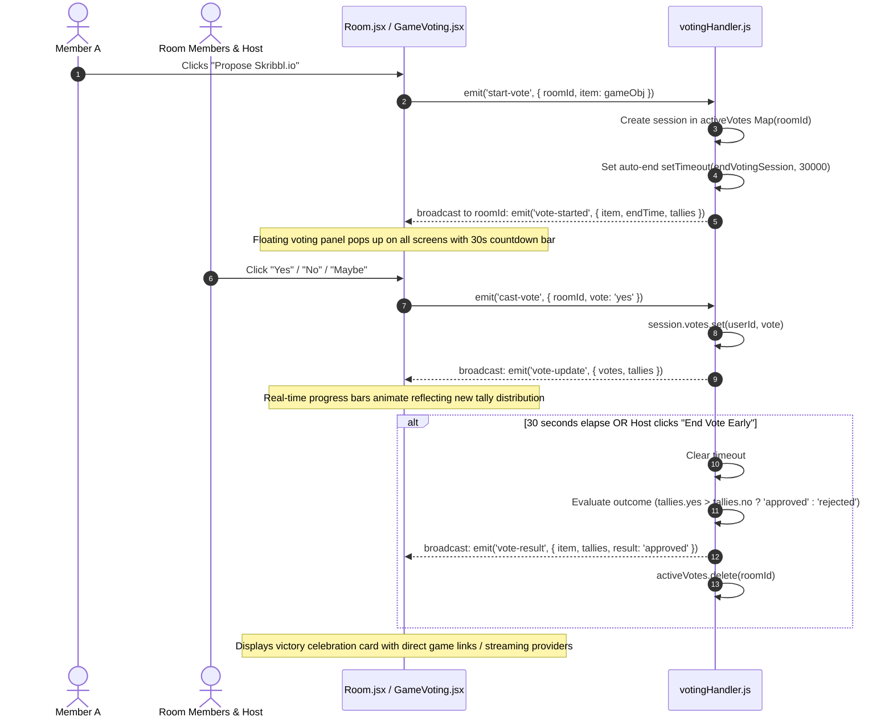
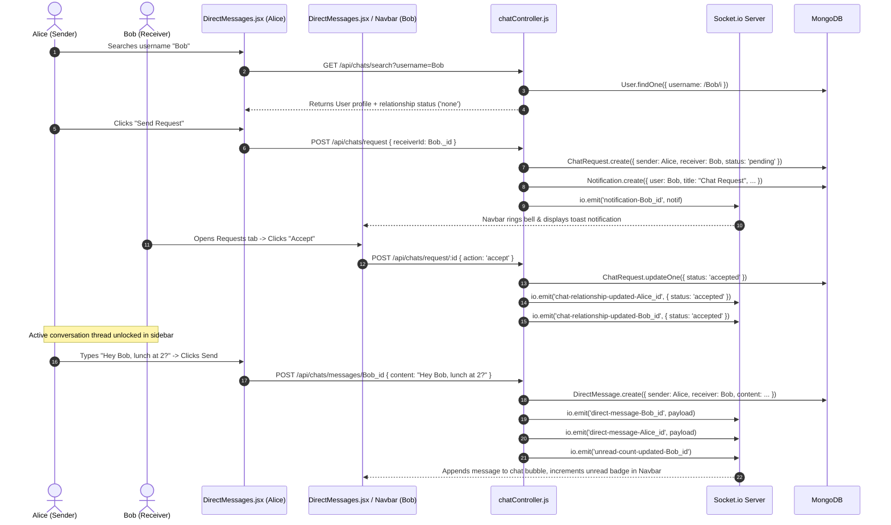

# 🗺️ WHERE TO? — Comprehensive Engineering Project Guide & Interview Manual

> **Target Audience:** Third-Year Engineering Student preparing for Software Engineering (Full-Stack / Backend / Frontend) Technical Interviews.  
> **Repository:** `Where To?` (Full-Stack Real-Time Collaborative Social & Exploration Platform)  
> **Source Roots:** `backend/` and `frontend/`

---

## 📑 Table of Contents
1. [Overview](#1-overview)
2. [Tech Stack & Justifications](#2-tech-stack--justifications)
3. [Annotated Folder Structure](#3-annotated-folder-structure)
4. [System Architecture & Data Flow](#4-system-architecture--data-flow)
5. [Database Design & Mongoose Schemas](#5-database-design--mongoose-schemas)
6. [Complete REST API Reference](#6-complete-rest-api-reference)
7. [Authentication & Authorization Deep-Dive](#7-authentication--authorization-deep-dive)
8. [Frontend Flow, Routing & State Management](#8-frontend-flow-routing--state-management)
9. [End-to-End Feature Traces & Sequence Diagrams](#9-end-to-end-feature-traces--sequence-diagrams)
10. [Core Computer Science & Engineering Concepts to Learn](#10-core-computer-science--engineering-concepts-to-learn)
11. [Environment Configuration & Local Setup Guide](#11-environment-configuration--local-setup-guide)
12. [Codebase Weak Points, Architectural Bottlenecks & Improvements](#12-codebase-weak-points-architectural-bottlenecks--improvements)
13. [20 Technical Interview Questions & Code-Accurate Answers](#13-20-technical-interview-questions--code-accurate-answers)
14. [Elevator Pitches: 30-Second, 2-Minute, and 5-Minute Scripts](#14-elevator-pitches-30-second-2-minute-and-5-minute-scripts)

---

## 1. Overview

### What the Project Does
**Where To?** is a real-time collaborative social and local discovery web application designed to eliminate group indecision (the infamous *"Where should we go?"* or *"Bhai kahan jaayein?"* problem). It bridges two distinct modes of user interaction:
1. **Public Solo Exploration (`/explore`):** A zero-login, instant place finder that uses browser GPS coordinates or text search, coupled with proximity biasing, tiered distance matching, and category filtering to discover cafes, parks, viewpoints, and cultural venues.
2. **Collaborative Squad Hubs (`/room/:roomId` & `/messages`):** A real-time, room-based collaborative ecosystem where groups can join using 6-character room codes or public lobby listings to:
   - Calculate a **Geographic Centroid Midpoint** among all squad members' locations so no participant travels an unfair distance.
   - Run **Synchronized Multiplayer Voting Sessions** (Yes / No / Maybe with 30-second countdowns) on activities, games, and places.
   - Discover movies via **TMDB API** integration mapped to moods, genres, and streaming availability (Netflix, Prime Video, Disney+).
   - Sync study sessions using a server-authoritative **Pomodoro Timer** broadcasting tick events to all connected clients.
   - Engage in **1-on-1 Direct Messaging (DMs)**, connection requests, and real-time alerts.
   - Curate and share a **Memories Diary** with Cloudinary image streaming and visibility toggles (`public`, `connections`, `private`).

### Who Uses It
- **College Students & Friend Squads:** Groups trying to agree on weekend hangouts, study sessions, or online party games without chaotic multi-app coordination.
- **Remote / Distributed Groups:** Friends living across different neighborhoods of a city seeking a fair midpoint meeting spot.
- **Solo Explorers & Digital Nomads:** Individuals needing quick, curated recommendations for study cafes, scenic viewpoints, or bookstores near their immediate GPS location.
- **Study Groups:** Cohorts requiring synchronized Pomodoro focus intervals alongside shared chat and personal task tracking.

### Key Features
| Pillar | Feature | Codebase Implementation |
|---|---|---|
| **Location Discovery** | Proximity Biased Search & Autocomplete | `backend/controllers/placeController.js`, `frontend/src/pages/Explore.jsx` |
| **Location Discovery** | Landmark-First Match & 3-Tier Sorting | Rank 0 (Exact name match) to Rank 2 (Address match); Tier 1 (<100km), Tier 2 (India >100km), Tier 3 (Global) |
| **Location Discovery** | Wikimedia Commons Real Photo Resolution | MD5 hash sharding of Wikimedia filenames to extract direct CDNs without extra API keys |
| **Collaboration** | Ephemeral Rooms with 6-Char Codes | Unique random room generator (`generateRoomCode.js`) excluding ambiguous characters (`0`, `O`, `I`, `1`) |
| **Collaboration** | Geographic Centroid Calculation | Statistical centroid aggregation $(\frac{\sum \text{lat}}{N}, \frac{\sum \text{lng}}{N})$ in `outingHandler.js` |
| **Collaboration** | Synchronized Pomodoro Timers | Server-side `setInterval` in `timerHandler.js` broadcasting `timer-update` every second |
| **Collaboration** | Real-Time Voting Engine | 30-second auto-expiring in-memory tally engine (`votingHandler.js`) |
| **Social / Messaging** | 1-on-1 Direct Messaging | Connection request lifecycle (`ChatRequest`), 30-minute message edit window, unread count tracking (`DirectMessage`) |
| **Social / Media** | Photo Memories Feed | In-memory Multer buffer streaming directly to Cloudinary (`Memory.js`, `memoryController.js`) |
| **Automation** | Outing Reminders & TTL Expiry | Native MongoDB TTL indices (24h room auto-deletion, 48h chat message purge, 5min OTP expiration) + 2-min node scheduler (`reminderScheduler.js`) |

---

## 2. Tech Stack & Justifications

### Backend Technologies (`backend/package.json`)

| Package / Tool | Version | Purpose in Codebase | Engineering Justification |
|---|---|---|---|
| **Node.js** | `>=18.0.0` | Server runtime | Event-driven, non-blocking I/O ideal for real-time WebSocket traffic and concurrent HTTP requests. |
| **Express.js** | `^4.21.0` | REST API routing & middleware pipeline | Minimalist web framework providing simple middleware chaining (auth guard, error handler, Multer). |
| **MongoDB Atlas** | Cloud | Primary NoSQL document persistence | Flexible schema model allows nested user arrays, dynamic join requests, and native **TTL (Time-To-Live)** indices. |
| **Mongoose** | `^8.8.0` | Object Data Modeling (ODM) | Enforces schema validation, pre-save hooks (password hashing), instance methods (`comparePassword`), and populate joins. |
| **Socket.io** | `^4.8.0` | Bidirectional WebSocket communication | Manages room-level broadcasts (`io.to(roomId)`), user-specific events (`direct-message-${id}`), and fallback HTTP long-polling. |
| **jsonwebtoken (JWT)** | `^9.0.0` | Stateless authentication tokens | Cryptographically signed tokens (`HS256`) containing `userId` and 7-day expiration, eliminating server-side session stores. |
| **bcryptjs** | `^2.4.3` | One-way password hashing | Hashes user passwords using adaptive salt rounds (`genSalt(12)`), mitigating brute-force and rainbow table attacks. |
| **multer** | `^2.2.0` | Multipart/form-data handler | Parses incoming file uploads in-memory (`multer.memoryStorage()`) with 2MB/5MB bounds, avoiding disk writes on ephemeral cloud dynos. |
| **cloudinary** | `^2.10.0` | Cloud media asset management | Streams memory buffers directly via `upload_stream` to store optimized, CDN-hosted avatars and memory images. |
| **axios** | `^1.7.0` | Outbound HTTP requests | Fetches external data from Geoapify (places/geocoding), TMDB (movie catalogs), Brevo (HTTPS transactional email), and OAuth token endpoints. |
| **nodemailer** | `^9.0.3` | SMTP transport fallback | Provides fallback email delivery via Gmail SMTP during local development when Brevo API keys are unset. |
| **pdfkit** | `^0.19.1` | Programmatic PDF generation | Reserved for exporting outing itineraries and project documentation reports. |
| **dotenv** | `^16.4.0` | Environment variable loader | Injects configuration secrets from `.env` into `process.env` during runtime. |
| **cors** | `^2.8.5` | Cross-Origin Resource Sharing | Regulates browser API calls across `CLIENT_URL`, `FRONTEND_URL`, `localhost:5173`, and any `*.vercel.app` domain. |
| **nodemon** | `^3.1.14` | Development auto-reloader | Monitors backend source changes and automatically restarts the Node process. |

### Frontend Technologies (`frontend/package.json`)

| Package / Tool | Version | Purpose in Codebase | Engineering Justification |
|---|---|---|---|
| **React** | `^19.2.6` | Component-based UI library | Declarative UI rendering, fast virtual DOM diffing, and state-driven reactive UI updates. |
| **Vite** | `^8.0.12` | Next-generation frontend bundler | Extremely fast Hot Module Replacement (HMR) powered by native ES modules (ESM) and optimized Rollup production builds. |
| **React Router DOM** | `^7.17.0` | Client-side Single Page Application (SPA) routing | Declarative path matching (`Routes`, `Route`), nested routes, programmatic redirection (`useNavigate`), and URL search parameter management. |
| **Tailwind CSS** | `^3.4.19` | Utility-first styling framework | Enforces design consistency through custom design tokens, dark-mode variant classes, and minimal production CSS output. |
| **Socket.io Client** | `^4.8.3` | Real-time WebSocket client | Maintains persistent connection with the backend, listening for room ticks, voting tallies, notifications, and direct messages. |
| **Axios** | `^1.18.0` | HTTP client with interceptors | Provides centralized request interceptors (attaching `Bearer ${token}`) and response interceptors (handling global 401 token expiry). |
| **React Toastify** | `^11.1.0` | Notification toast alerts | Non-intrusive feedback for actions (e.g., room code copied, message received, errors). |
| **React Icons** | `^5.6.0` | Iconography library | Lightweight SVG icons from Feather (`Fi*`), FontAwesome (`Fa*`), and HeroIcons (`Hi*`). |

---

## 3. Annotated Folder Structure

```
Where To/
├── backend/
│   ├── config/
│   │   └── db.js                      # MongoDB connection using mongoose.connect()
│   ├── controllers/
│   │   ├── authController.js          # Register (with Email OTP), Login, Me, OAuth (Google/GitHub), Profile update
│   │   ├── chatController.js          # DM lifecycle, user search, request acceptance, message history, edit/delete
│   │   ├── memoryController.js        # Cloudinary media streaming, user memories, public community feed
│   │   ├── movieController.js         # TMDB movie discover API, mood-to-genre mapping, fallback catalog, providers
│   │   ├── notificationController.js   # Read/clear user notifications
│   │   ├── outingPlanController.js    # Outing itinerary scheduling, host validation, cancellation broadcast
│   │   ├── placeController.js         # Geoapify places discovery, Haversine formula, tiered sorting, Wikimedia MD5
│   │   ├── roomController.js          # Room CRUD, code joining, host request approval, kicking, hard cascade deletion
│   │   └── userController.js          # Place bookmarking, saved places fetch/delete, user profile, cascade account deletion
│   ├── middleware/
│   │   ├── authMiddleware.js          # 'protect' (strict JWT verification) and 'optionalAuth' (permissive)
│   │   └── errorHandler.js            # Global error interceptor handling Mongoose ValidationError, 11000 duplicate keys, JWT errors
│   ├── models/                        # 10 Mongoose Document Schemas
│   │   ├── ChatRequest.js             # 1-on-1 friendship request tracking ('pending', 'accepted', 'rejected')
│   │   ├── DirectMessage.js           # Private DMs with read flags and 30-minute edit tracking
│   │   ├── EmailOTP.js                # 6-digit numeric OTP with 5-minute MongoDB TTL index
│   │   ├── Memory.js                  # Cloudinary image references with visibility scopes ('public', 'private', 'connections')
│   │   ├── Message.js                 # Room lobby messages with 48-hour MongoDB TTL index
│   │   ├── Notification.js            # User alerts (reminders, join requests, cancellations)
│   │   ├── OutingPlan.js              # Scheduled meetup details (room, place, lat/lng, dateTime, creator, members)
│   │   ├── Room.js                    # Room lobbies with 24-hour MongoDB TTL index, joinRequests, member arrays
│   │   ├── SavedPlace.js              # Bookmarked destinations per user with compound unique index ({ user: 1, osmId: 1 })
│   │   └── User.js                    # User accounts with bcrypt pre-save hashing, OAuth IDs, bio word caps, username constraints
│   ├── routes/                        # Express router definitions
│   │   ├── authRoutes.js              # /api/auth/*
│   │   ├── chatRoutes.js              # /api/chats/*
│   │   ├── memoryRoutes.js            # /api/memories/*
│   │   ├── movieRoutes.js             # /api/movies/*
│   │   ├── notificationRoutes.js      # /api/notifications/*
│   │   ├── outingPlanRoutes.js        # /api/outing-plans/*
│   │   ├── placeRoutes.js             # /api/places/*
│   │   ├── roomRoutes.js              # /api/rooms/*
│   │   └── userRoutes.js              # /api/user/*
│   ├── socket/                        # Real-Time Socket.io event modules
│   │   ├── outingHandler.js           # Group location aggregation, centroid calculation, Geoapify search
│   │   ├── socketHandler.js           # Master socket entry, JWT handshake verification, room presence, message dispatch
│   │   ├── timerHandler.js            # Server-authoritative Pomodoro countdown ticks (1s setInterval)
│   │   └── votingHandler.js           # 30-second proposal countdown, vote tallying (yes/no/maybe), result evaluation
│   ├── utils/
│   │   ├── generateRoomCode.js        # Collision-free 6-character room code generator excluding ambiguous glyphs
│   │   └── reminderScheduler.js       # Background cron running every 2 minutes for upcoming meetup alerts
│   ├── .env.example                   # Template environment variables
│   ├── package.json                   # Backend dependencies and startup scripts
│   └── server.js                      # Root server initialization, CORS policy, Socket.io attachment, route binding
│
├── frontend/
│   ├── public/                        # Static public assets
│   ├── src/
│   │   ├── components/
│   │   │   ├── chat/
│   │   │   │   └── ChatLounge.jsx     # Room squad presence indicator and chill lounge
│   │   │   ├── games/
│   │   │   │   ├── GameList.jsx       # Catalog of browser games (Skribbl, Gartic, Codenames, Chess, Ludo)
│   │   │   │   └── GameVoting.jsx     # Real-time proposal modal with voting tally bars and provider logos
│   │   │   ├── layout/
│   │   │   │   ├── Footer.jsx         # Application footer with brand anchors
│   │   │   │   ├── Logo.jsx           # Animated brand vector logo
│   │   │   │   └── Navbar.jsx         # Responsive navbar with unread DM counter, notification dropdown, theme toggle
│   │   │   ├── movies/
│   │   │   │   ├── MovieCard.jsx      # TMDB movie summary card with 'Propose' action
│   │   │   │   ├── MovieFilters.jsx   # Mood, genre, and language selector dropdowns
│   │   │   │   └── WatchLounge.jsx    # Movie discovery container with skeleton loading
│   │   │   ├── outing/
│   │   │   │   ├── OutingFilters.jsx  # Location submission form with live squad submission roster
│   │   │   │   ├── OutingLounge.jsx   # Outing state manager coordinating filters and results
│   │   │   │   └── OutingResults.jsx  # Centroid venue display with voting and scheduling triggers
│   │   │   ├── places/
│   │   │   │   └── PlaceCard.jsx      # Place summary card with travel time badges, Google Maps links, and save button
│   │   │   └── study/
│   │   │       ├── PomodoroTimer.jsx  # Circular SVG countdown timer with synchronized work/break controls
│   │   │       ├── StudyLounge.jsx    # Study workspace split into Pomodoro timer and personal task list
│   │   │       └── TodoList.jsx       # LocalStorage-persisted personal checklist
│   │   ├── context/
│   │   │   ├── AuthContext.jsx        # JWT storage (sessionStorage), user state, login, register, OAuth bootstrap
│   │   │   ├── SocketContext.jsx      # Persistent io() connection manager with JWT auth handshake
│   │   │   └── ThemeContext.jsx       # Light/Dark mode state toggler injecting 'dark' class on <html>
│   │   ├── hooks/
│   │   │   └── useGeolocation.js      # Custom React hook wrapping navigator.geolocation.getCurrentPosition
│   │   ├── pages/
│   │   │   ├── CreateRoom.jsx         # Room generation form, privacy toggle, friend DM invite modal
│   │   │   ├── DirectMessages.jsx     # 1-on-1 private messaging interface, user search, request management, edit/delete
│   │   │   ├── Explore.jsx            # Public solo place finder with category vibes, distance radius, and autocomplete
│   │   │   ├── Guide.jsx              # Comprehensive platform user manual and interactive FAQ
│   │   │   ├── Home.jsx               # Dynamic landing: Particle hero & sandbox for guests; Dashboard & plans for users
│   │   │   ├── JoinRoom.jsx           # 6-character code input tab + active public lobbies directory with request notes
│   │   │   ├── Login.jsx              # Password login + Google/GitHub OAuth action buttons
│   │   │   ├── OAuthSuccess.jsx       # Intermediary OAuth callback extractor parsing ?token=...
│   │   │   ├── Profile.jsx            # User profile card, 30-day username lock, bio word counter, Cloudinary memory diary
│   │   │   ├── Register.jsx           # Signup form with 6-digit Email OTP modal verification
│   │   │   ├── Room.jsx               # Real-time room hub coordinating chat, host sidebar, kicks, deletions, and lounges
│   │   │   └── SavedPlaces.jsx        # Dedicated user bookmark dashboard with navigation links
│   │   ├── services/                  # Modular Axios API wrappers
│   │   │   ├── api.js                 # Axios instance with request/response interceptors (Bearer token & 401 logout)
│   │   │   ├── authService.js         # /api/auth and /api/user endpoints
│   │   │   ├── chatService.js         # /api/chats endpoints
│   │   │   ├── memoryService.js       # /api/memories endpoints
│   │   │   ├── movieService.js        # /api/movies endpoints
│   │   │   ├── notificationService.js # /api/notifications endpoints
│   │   │   ├── outingPlanService.js   # /api/outing-plans endpoints
│   │   │   ├── placeService.js        # /api/places endpoints
│   │   │   └── roomService.js         # /api/rooms endpoints
│   │   ├── utils/
│   │   │   └── avatarHelper.js        # onError fallback resolving broken profile avatars to DiceBear SVG silhouettes
│   │   ├── App.jsx                    # Root route hierarchy with ProtectedRoute and GuestRoute wrappers
│   │   ├── index.css                  # Tailwind directives, custom glassmorphism utilities, dark-mode variables
│   │   └── main.jsx                   # React 19 createRoot entry wrapping App with Auth, Socket, and Theme Providers
│   ├── package.json                   # Frontend dependencies and Vite build scripts
│   ├── tailwind.config.js             # Extended color tokens (neon-cyan, primary-500, dark-900)
│   └── vite.config.js                 # Vite bundler configuration with React plugin
│
├── PROJECT_GUIDE.md                   # This comprehensive interview preparation manual
└── project_report.pdf                 # Architectural specification report
```

---

## 4. System Architecture & Data Flow

### Architectural Paradigm
The system implements a **Decoupled Client-Server Architecture** utilizing a **Hybrid Communication Protocol**:
1. **Stateless HTTP/REST (Port 5000 / API Gateway):** Used for CRUD operations, authentication handshakes, multi-step queries (places, movies), file uploads, and initial data hydration.
2. **Stateful WebSocket (Socket.io Engine):** Used for low-latency, bidirectional, event-driven interactions such as live room chat, participant presence, Pomodoro timer ticks, 30-second proposal countdowns, and instant direct message alerts.

### High-Level System Architecture Diagram



### Communication Protocols Breakdown
1. **HTTP/1.1 REST Endpoints:** Protected by `Authorization: Bearer <JWT>`. Returns standard JSON schemas with HTTP status codes (`200 OK`, `201 Created`, `400 Bad Request`, `401 Unauthorized`, `403 Forbidden`, `404 Not Found`, `500 Internal Error`).
2. **WebSocket (Socket.io v4):** 
   - Initial HTTP long-polling handshake upgrading to native WebSocket (`transports: ['websocket', 'polling']`).
   - Authentication token is sent inside `socket.handshake.auth.token` during the connection phase.
   - Handshake middleware verifies the token and binds the authenticated Mongoose user data (`socket.userId`, `socket.username`, `socket.avatar`) directly to the socket instance.
   - Leverages **Socket.io Rooms** (`socket.join(roomId)`) for scoped group communication and isolated multicast message delivery.

---

## 5. Database Design & Mongoose Schemas

The database layer utilizes **MongoDB Atlas** managed via **Mongoose 8**. It consists of 10 primary collections, featuring embedded subdocuments, relational object references, and automated lifecycle TTL indices.

### Entity Relationship Diagram (ERD)



### Detailed Schema Specifications

#### 1. `User` Schema (`backend/models/User.js`)
- `username`: String, required, unique, trim, minlength 3, maxlength 20. Enforces Instagram format (alphanumeric, underscores, non-consecutive periods).
- `name`: String, trim, default `''`.
- `lastUsernameChange`: Date, default `null`. Used in `authController.js` to enforce a **30-day throttle** between handle updates.
- `bio`: String, trim, default `''`. Enforces a strict **300-word ceiling** via controller validation.
- `email`: String, required, unique, lowercase, regex-validated for email format. In `authController.js`, restricted to valid `@gmail.com` accounts.
- `password`: String, required, minlength 6, `select: false` (excluded from query projections by default to prevent leakage).
- `avatar`: String, defaults to dynamic DiceBear SVG URL.
- `googleId`: String, unique, `sparse: true` (allows multiple documents without this field).
- `githubId`: String, unique, `sparse: true`.
- `savedPlaces`: Array of `ObjectId` referencing `SavedPlace`.
- **Mongoose Middleware:**
  - `pre('save')`: Hashes password using `bcrypt.genSalt(12)` whenever `isModified('password')` is true.
  - `methods.comparePassword(enteredPassword)`: Asynchronous bcrypt comparison.

#### 2. `Room` Schema (`backend/models/Room.js`)
- `code`: String, required, unique, uppercase, 6 characters (generated from character set omitting `0, O, I, 1`).
- `name`: String, maxlength 40, defaults to `${username}'s Room`.
- `purpose`: String, maxlength 200, default `''`.
- `host`: `ObjectId` referencing `User`, required.
- `members`: Array of `ObjectId` referencing `User`.
- `pastMembers`: Array of `ObjectId` referencing `User` (tracks past participants so they can re-join without re-entering codes).
- `joinRequests`: Array of subdocuments:
  - `{ user: ObjectId (ref User), note: String (max 200), status: 'pending'|'accepted'|'rejected', createdAt: Date }`.
- `activity`: String, enum: `['none', 'game', 'watch', 'outing', 'study', 'chat']`, default `'none'`.
- `isPublic`: Boolean, default `true` (determines visibility in public lobby directory).
- `isActive`: Boolean, default `true`.
- `expiresAt`: Date, default `() => new Date(Date.now() + 24 * 60 * 60 * 1000)`.
- **Index:** `{ expiresAt: 1 }` with `{ expiresAfterSeconds: 0 }`. Native MongoDB TTL thread automatically purges expired rooms 24 hours post-creation.

#### 3. `Message` Schema (`backend/models/Message.js`)
- `room`: `ObjectId` referencing `Room`, required.
- `sender`: `ObjectId` referencing `User` (null for system join/leave broadcasts).
- `senderName`: String, default `'System'`.
- `content`: String, required, maxlength 1000.
- `type`: String, enum: `['text', 'system']`, default `'text'`.
- `isEdited`: Boolean, default `false`.
- `createdAt`: Date, default `Date.now`.
- **Index:** `{ createdAt: 1 }` with `{ expiresAfterSeconds: 172800 }`. Automatically deletes chat logs after 48 hours to minimize database bloat.

#### 4. `SavedPlace` Schema (`backend/models/SavedPlace.js`)
- `user`: `ObjectId` referencing `User`, required.
- `name`: String, required.
- `category`: String, default `'Place'`.
- `lat`: Number, required; `lng`: Number, required.
- `osmId`: String (Geoapify/OSM unique place identifier).
- `address`: String, default `''`.
- `savedAt`: Date, default `Date.now`.
- **Compound Index:** `{ user: 1, osmId: 1 }` with `{ unique: true, sparse: true }`. Prevents duplicate bookmarks of the same physical spot by a single user.

#### 5. `Memory` Schema (`backend/models/Memory.js`)
- `user`: `ObjectId` referencing `User`, required.
- `imageUrl`: String, required (Cloudinary HTTPS delivery URL).
- `publicId`: String, required (Cloudinary public asset key required for programmatic deletion).
- `caption`: String, default `''`.
- `visibility`: String, enum: `['public', 'private', 'connections']`, default `'public'`.
- `createdAt`: Date, default `Date.now`.

#### 6. `Notification` Schema (`backend/models/Notification.js`)
- `user`: `ObjectId` referencing `User`, required.
- `title`: String, required.
- `message`: String, required.
- `type`: String, enum: `['reminder', 'info']`, default `'reminder'`.
- `isRead`: Boolean, default `false`.
- `createdAt`: Date, default `Date.now`.

#### 7. `OutingPlan` Schema (`backend/models/OutingPlan.js`)
- `roomId`: `ObjectId` referencing `Room`, required.
- `roomName`: String, required.
- `placeName`: String, required.
- `address`: String, default `''`.
- `lat`: Number, required; `lng`: Number, required.
- `mapsLink`: String, default `''`.
- `dateTime`: Date, required.
- `creator`: `ObjectId` referencing `User`, required.
- `members`: Array of `ObjectId` referencing `User`.
- `reminderSent`: Boolean, default `false`.
- `createdAt`: Date, default `Date.now`.

#### 8. `EmailOTP` Schema (`backend/models/EmailOTP.js`)
- `email`: String, required, lowercase, trim.
- `code`: String, required (6-digit numeric string).
- `createdAt`: Date, default `Date.now`, `expires: 300`. MongoDB TTL deletes records automatically after 5 minutes (300 seconds).

#### 9. `ChatRequest` Schema (`backend/models/ChatRequest.js`)
- `sender`: `ObjectId` referencing `User`, required.
- `receiver`: `ObjectId` referencing `User`, required.
- `status`: String, enum: `['pending', 'accepted', 'rejected']`, default `'pending'`.
- `createdAt`: Date, default `Date.now`.

#### 10. `DirectMessage` Schema (`backend/models/DirectMessage.js`)
- `sender`: `ObjectId` referencing `User`, required.
- `receiver`: `ObjectId` referencing `User`, required.
- `content`: String, required, maxlength 1000.
- `isRead`: Boolean, default `false`.
- `isEdited`: Boolean, default `false`.
- `createdAt`: Date, default `Date.now`.

---

## 6. Complete REST API Reference

All protected routes require an HTTP header formatted as:  
`Authorization: Bearer <JWT_TOKEN>`

### 🔑 Authentication (`/api/auth`)
| Method | Route | Auth? | Purpose | Request Body | Response Payload |
|---|---|:---:|---|---|---|
| `POST` | `/send-otp` | No | Sends 6-digit OTP to `@gmail.com` via Brevo HTTPS or Nodemailer | `{ email: string }` | `{ message: string }` |
| `POST` | `/register` | No | Registers new account after matching code from `EmailOTP` | `{ username, email, password, code }` | `{ _id, username, email, avatar, token }` |
| `POST` | `/login` | No | Authenticates credentials against User schema | `{ identifier, password }` | `{ _id, username, email, avatar, token }` |
| `GET` | `/me` | **Yes** | Fetches active authenticated user profile | None | `{ _id, username, name, bio, lastUsernameChange, email, avatar, createdAt }` |
| `PUT` | `/update-profile` | **Yes** | Updates name, bio, username (30d limit), and avatar photo | `multipart/form-data`: `name`, `username`, `bio`, `photo` | `{ _id, username, name, bio, email, avatar, lastUsernameChange, message }` |
| `GET` | `/google` | No | Initiates Google OAuth consent flow or mock bypass | None | `302 Redirect to Google OAuth URL` |
| `GET` | `/google/callback` | No | Receives Google auth code, exchanges token, creates/finds user | Query: `?code=string` | `302 Redirect to /oauth-success?token=<JWT>` |
| `GET` | `/github` | No | Initiates GitHub OAuth flow or mock bypass | None | `302 Redirect to GitHub OAuth URL` |
| `GET` | `/github/callback` | No | Receives GitHub auth code, exchanges token, creates/finds user | Query: `?code=string` | `302 Redirect to /oauth-success?token=<JWT>` |

### 👤 User & Saved Places (`/api/user`)
| Method | Route | Auth? | Purpose | Request Body | Response Payload |
|---|---|:---:|---|---|---|
| `POST` | `/places/save` | **Yes** | Saves destination to user's favorites profile | `{ name, category, lat, lng, osmId, address }` | `SavedPlace Document (201 Created)` |
| `GET` | `/places` | **Yes** | Retrieves all saved bookmarks for logged-in user | None | `Array<SavedPlace Document>` |
| `DELETE` | `/places/:id` | **Yes** | Deletes saved bookmark belonging to user | None | `{ message: "Place removed", id: string }` |
| `DELETE` | `/` | **Yes** | Cascade deletion of entire account and related data | None | `{ message: "Account successfully deleted" }` |
| `GET` | `/profile/:id` | **Yes** | Retrieves public profile card data & saved places count | None | `{ _id, username, name, bio, avatar, createdAt, savedPlacesCount }` |

### 📍 Places & Geocoding (`/api/places`)
| Method | Route | Auth? | Purpose | Request Body | Response Payload |
|---|---|:---:|---|---|---|
| `POST` | `/nearby` | No | Discovers spots via Geoapify with proximity biasing and tiered sorting | `{ lat, lng, vibe, mood, distance, searchLocation, isCustomSearch, prependedPlace, subFilters }` | `{ places: Array<Place>, count, mood, radius, resolvedLocation }` |
| `GET` | `/autocomplete` | No | Instant location suggestions biased by proximity | Query: `?text=string&lat=num&lng=num` | `{ suggestions: Array<AutocompleteMatch> }` |

### 🏠 Rooms (`/api/rooms`)
| Method | Route | Auth? | Purpose | Request Body | Response Payload |
|---|---|:---:|---|---|---|
| `POST` | `/create` | **Yes** | Generates unique 6-char code and initializes room | `{ name?, purpose?, isPublic?: boolean }` | `Room Document (201 Created)` |
| `POST` | `/join` | **Yes** | Enters room via 6-character code | `{ code: string }` | `Room Document` |
| `POST` | `/:id/rejoin` | **Yes** | Re-enters previously joined room without code | None | `Room Document` |
| `GET` | `/my-rooms` | **Yes** | Retrieves active rooms user hosts or participated in | None | `Array<Room Document + isHost + isCurrentMember>` |
| `GET` | `/active` | **Yes** | Retrieves public lobbies excluding user's own | None | `Array<Room Document>` |
| `GET` | `/:id` | **Yes** | Retrieves detailed room status, members, and requests | None | `Room Document` |
| `PATCH` | `/:id/activity` | **Yes (Host)** | Modifies current room activity state | `{ activity: string }` | `{ activity: string }` |
| `GET` | `/:id/messages` | **Yes** | Retrieves up to 100 historical room messages | None | `Array<Message Document>` |
| `POST` | `/:id/leave` | **Yes** | Removes user from active room members | None | `{ message: "Left room" }` |
| `DELETE` | `/:id` | **Yes (Host)** | Hard deletes room and purges all lobby messages | None | `{ message: "Room deleted successfully" }` |
| `POST` | `/:id/request-join` | **Yes** | Submits join request with custom note to host | `{ note?: string }` | `{ message: "Join request sent successfully" }` |
| `POST` | `/:id/respond-request`| **Yes (Host)** | Accepts or rejects user's join request | `{ requestId: string, action: "accept"|"reject" }` | `{ message, room: Room Document }` |
| `POST` | `/:id/remove-member` | **Yes (Host)** | Kicks user from room and rejects past requests | `{ memberId: string }` | `{ message, room: Room Document }` |
| `POST` | `/:id/invite-friend` | **Yes (Host)** | Sends direct message invitation link to a friend | `{ friendId: string }` | `{ message, dm: DirectMessage Document }` |

### 💬 Direct Messaging & Connections (`/api/chats`)
| Method | Route | Auth? | Purpose | Request Body | Response Payload |
|---|---|:---:|---|---|---|
| `GET` | `/relationships`| **Yes** | Maps connection statuses across all users | None | `{ [userId]: { status, requestId } }` |
| `GET` | `/friends` | **Yes** | Retrieves accepted friend objects for invitations | None | `Array<User Document>` |
| `GET` | `/search` | **Yes** | Case-insensitive search for username excluding self | Query: `?username=string` | `{ user, relationship, requestId }` |
| `POST` | `/request` | **Yes** | Dispatches connection request and triggers notification | `{ receiverId: string }` | `ChatRequest Document (201 Created)` |
| `POST` | `/request/:requestId`| **Yes** | Accepts or declines incoming connection request | `{ action: "accept" | "reject" }` | `ChatRequest Document` |
| `GET` | `/active` | **Yes** | Retrieves connected chat threads with last message & unread count | None | `Array<{ user, lastMessage, unreadCount }>` |
| `GET` | `/requests` | **Yes** | Retrieves incoming pending connection invitations | None | `Array<ChatRequest Document>` |
| `GET` | `/unread-count` | **Yes** | Counts all unread private messages across all senders | None | `{ unreadCount: number }` |
| `POST` | `/mark-read/:senderId`| **Yes**| Marks all messages from a specific sender as read | None | `{ message: "Messages marked as read" }` |
| `GET` | `/messages/:otherUserId`| **Yes**| Fetches message history with a connected user | None | `Array<DirectMessage Document>` |
| `POST` | `/messages/:otherUserId`| **Yes**| Dispatches private message and socket event | `{ content: string }` | `DirectMessage Document (201 Created)` |
| `PUT` | `/message/:messageId`| **Yes** | Edits message content (within 30-minute window) | `{ content: string }` | `DirectMessage Document` |
| `DELETE`| `/message/:messageId`| **Yes** | Deletes a direct message authored by user | None | `{ message: "Message deleted successfully" }` |
| `DELETE`| `/conversation/:otherUserId`| **Yes**| Clears all DMs between both users | None | `{ message: "Conversation history cleared successfully" }` |
| `DELETE`| `/connection/:otherUserId`| **Yes**| Deletes friendship record and clears conversations | None | `{ message: "Removed from chats successfully" }` |

### 📅 Outing Plans (`/api/outing-plans`)
| Method | Route | Auth? | Purpose | Request Body | Response Payload |
|---|---|:---:|---|---|---|
| `POST` | `/create` | **Yes (Host)** | Schedules meetup for room members | `{ roomId, placeName, address, lat, lng, mapsLink, dateTime }` | `OutingPlan Document (201 Created)` |
| `GET` | `/my-plans` | **Yes** | Fetches upcoming meetups for user (buffer: now - 6h) | None | `Array<OutingPlan Document>` |
| `GET` | `/room/:roomId`| **Yes** | Fetches scheduled plan for specific room | None | `OutingPlan Document` |
| `DELETE`| `/:id` | **Yes (Creator)**| Cancels plan, notifies participants, emits socket event | None | `{ message: "Outing plan cancelled successfully" }` |

### 📸 Memories (`/api/memories`)
| Method | Route | Auth? | Purpose | Request Body | Response Payload |
|---|---|:---:|---|---|---|
| `POST` | `/` | **Yes** | Uploads image via Multer stream to Cloudinary | `multipart/form-data`: `caption`, `visibility`, `photo` | `Memory Document (201 Created)` |
| `GET` | `/feed` | **Yes** | Fetches public community memory posts | None | `Array<Memory Document>` |
| `GET` | `/user/:userId`| **Yes** | Fetches memories scoped by viewer relationship | None | `Array<Memory Document>` |
| `DELETE`| `/:id` | **Yes (Owner)** | Deletes Memory document and destroys Cloudinary asset | None | `{ message: "Memory deleted successfully" }` |

### 🎬 Movies (`/api/movies`)
| Method | Route | Auth? | Purpose | Request Body | Response Payload |
|---|---|:---:|---|---|---|
| `POST` | `/discover` | **Yes** | Queries TMDB discover or fallback catalog by genres/mood/language | `{ genres: Array<string>, mood: string, language: string }` | `{ movies: Array<Movie>, source: "tmdb"|"fallback" }` |
| `GET` | `/providers/:id`| **Yes** | Fetches streaming platforms (Netflix, Prime, etc.) | None | `{ providers: Array<{ provider_name, logo }> }` |

### 🔔 Notifications (`/api/notifications`)
| Method | Route | Auth? | Purpose | Request Body | Response Payload |
|---|---|:---:|---|---|---|
| `GET` | `/` | **Yes** | Fetches latest 50 notifications for user | None | `Array<Notification Document>` |
| `PATCH`| `/:id/read` | **Yes** | Marks individual notification as read | None | `Notification Document` |
| `DELETE`| `/clear` | **Yes** | Deletes all notifications for user | None | `{ message: "All notifications cleared" }` |

---

## 7. Authentication & Authorization Deep-Dive

### Step-by-Step Flow

#### 1. Registration Flow with Email OTP


#### 2. Traditional Password Login Flow
1. User enters `identifier` (username or email) and `password` on `frontend/src/pages/Login.jsx`.
2. Client calls `POST /api/auth/login`.
3. In `authController.js`, server finds the user matching `$or: [{ email: identifier.toLowerCase() }, { username: identifier }]` with `.select('+password')`.
4. Executes `await user.comparePassword(password)`. If false, returns `401 Unauthorized` (`"Invalid credentials"`).
5. Returns `generateToken(user._id)` along with basic user details.
6. `AuthContext.jsx` commits token and user to `sessionStorage`.

#### 3. Social OAuth 2.0 Flow (Google & GitHub)
1. User clicks **"Continue with Google"** (`GET /api/auth/google`) or **"Continue with GitHub"** (`GET /api/auth/github`).
2. **Demo Bypass Graceful Fallback:** If `GOOGLE_CLIENT_ID` or `GITHUB_CLIENT_ID` is unconfigured/placeholder in `.env`, the controller triggers `handleDemoBypass()`, automatically logging in a simulated user and redirecting directly to `/oauth-success?token=${token}`.
3. If configured, server issues a `302 Redirect` to the respective identity provider's OAuth consent screen with scopes (`profile email`).
4. User authorizes; provider redirects to backend callback (`/api/auth/google/callback?code=...` or `/api/auth/github/callback?code=...`).
5. Server makes a backend-to-backend `POST` request to exchange `code` for `access_token`.
6. Server calls Google/GitHub UserInfo APIs using the access token to fetch `id`, `email`, `name`, and `picture`/`avatar_url`.
7. `getOrCreateOAuthUser()` inspects MongoDB:
   - If user exists by `googleId`/`githubId`, it loads them.
   - If user exists by verified email, it links the OAuth ID.
   - If user does not exist, it generates a clean username (`User_XXXXX` or sanitized GitHub handle), generates a random 12-character password, hashes it, and saves the document.
8. Server issues `res.redirect("${FRONTEND_URL}/oauth-success?token=${token}")`.
9. `frontend/src/pages/OAuthSuccess.jsx` extracts `token` from URL search parameters, calls `loginWithToken(token)` (which fetches `/api/auth/me`), stores the session, and redirects to `/`.

### Token Storage Strategy & Interceptors
- **Client Storage:** Tokens are maintained in **`sessionStorage`** under the key `whereto_token`. This isolates sessions to the active browser tab lifecycle and mitigates persistence vulnerabilities on shared public terminals.
- **Request Interceptor (`frontend/src/services/api.js`):**
  ```javascript
  api.interceptors.request.use((config) => {
    const token = sessionStorage.getItem('whereto_token');
    if (token) config.headers.Authorization = `Bearer ${token}`;
    return config;
  });
  ```
- **Response Interceptor (`frontend/src/services/api.js`):**
  Listens for `error.response?.status === 401`. If intercepted, it purges `whereto_token` and `whereto_user` from `sessionStorage` and immediately routes the browser to `/login` (unless already on authentication pages).

### Middleware Protection Pipeline (`backend/middleware/authMiddleware.js`)
- **`protect` Middleware:**
  1. Reads `req.headers.authorization`.
  2. Extracts token after the `Bearer ` prefix.
  3. Verifies cryptographic signature using `jwt.verify(token, process.env.JWT_SECRET)`.
  4. Queries database: `await User.findById(decoded.id).select('-password')`.
  5. Attaches active user document to `req.user`. If token is invalid, expired, or user was deleted, aborts with `401 Unauthorized`.
- **`optionalAuth` Middleware:**
  Attempts token extraction and verification. If valid, attaches `req.user`; if invalid or absent, silently proceeds without throwing an error (used for public endpoints where user context is optional).

### Role-Based Access Control (RBAC) & Ownership Guards
Rather than maintaining an arbitrary `role` column, authorization is strictly **resource-ownership-driven**:
- **Room Host Guards:** Verified via `room.host.toString() === req.user.id`. Only the host can:
  - Toggle activities (`PATCH /api/rooms/:id/activity`).
  - Accept/reject join requests (`POST /api/rooms/:id/respond-request`).
  - Kick members (`POST /api/rooms/:id/remove-member`).
  - Delete rooms (`DELETE /api/rooms/:id`).
  - Schedule outings (`POST /api/outing-plans/create`).
  - Trigger midpoint searches (`find-outing-places`).
- **Message Author Guards:** Verified via `message.sender.toString() === req.user.id`. Enforces a strict **30-minute time limit** on message edits (`Date.now() - message.createdAt <= 30 * 60 * 1000`).
- **Memory Author Guards:** Verified via `memory.user.toString() === req.user.id` before issuing Cloudinary asset destruction.

---

## 8. Frontend Flow, Routing & State Management

### Routing Hierarchy (`frontend/src/App.jsx`)

The routing layer uses **React Router v7** with declarative route guards:

```mermaid
graph TD
    Root["App.jsx Routes"]
    
    Root --> PublicRoutes["Public Routes"]
    Root --> GuestRoutes["GuestRoute (Logged-Out Only)"]
    Root --> ProtectedRoutes["ProtectedRoute (Auth Required)"]

    PublicRoutes --> Home["/ (Home - Dynamic Guest/User View)"]
    PublicRoutes --> Explore["/explore (Solo Place Finder)"]
    PublicRoutes --> JoinRoom["/join-room (Code / Lobbies Directory)"]
    PublicRoutes --> Guide["/guide (Platform Manual)"]
    PublicRoutes --> OAuthSuccess["/oauth-success (Token Bridge)"]

    GuestRoutes --> Login["/login (Sign In Form)"]
    GuestRoutes --> Register["/register (Sign Up + OTP)"]

    ProtectedRoutes --> CreateRoom["/create-room (Room Wizard)"]
    ProtectedRoutes --> Room["/room/:roomId (Collaborative Lobby)"]
    ProtectedRoutes --> DMs["/messages & /chats (Direct Messaging)"]
    ProtectedRoutes --> Profile["/profile/:userId? (Profile & Memories)"]
    ProtectedRoutes --> SavedPlaces["/saved-places (Bookmarked Spots)"]
```



### Route Guards Explained
1. **`<ProtectedRoute>`:** Checks `isAuthenticated` and `loading` from `AuthContext`. If loading, renders a loading spinner. If unauthenticated, executes `<Navigate to="/login" replace />`.
2. **`<GuestRoute>`:** Prevents logged-in users from seeing login or registration screens. If authenticated, executes `<Navigate to="/" replace />`.

### Global State Management (React Context API)

#### 1. `AuthContext.jsx`
- **State:** `user`, `token`, `loading`.
- **Initialization:** Reads initial values synchronously from `sessionStorage` to avoid flicker.
- **Side Effect (`useEffect`):** If token exists, calls `authService.getMe()` to re-hydrate the latest profile details (bio, name, avatar).
- **Exposed Methods:** `login()`, `register()`, `logout()`, `loginWithToken()`, `updateUser()`.

#### 2. `SocketContext.jsx`
- **State:** `socket` (reference maintained via `useRef`), `connected` (boolean).
- **Lifecycle:** Re-evaluates whenever `isAuthenticated` or `token` changes.
  - When authenticated: Connects to backend via `io(URL, { auth: { token }, transports: ['websocket', 'polling'] })`.
  - When logged out: Explicitly calls `socketRef.current.disconnect()`, resets ref to `null`, and sets `connected = false`.

#### 3. `ThemeContext.jsx`
- **State:** `theme` (`'dark'` or `'light'`, persisted in `localStorage.whereto_theme`).
- **Side Effect:** Dynamically attaches or removes the `dark` and `light` classes from `document.documentElement` (`<html>`), triggering Tailwind CSS dark-mode styling rules across the DOM tree.

---

## 9. End-to-End Feature Traces & Sequence Diagrams

### Feature 1: Solo Place Exploration with Proximity Biasing (`/explore`)
**User Action:** User selects "Couples" -> "Beaches & Sunsets" -> "Nearby (2 km)" and clicks search.



---

### Feature 2: Collaborative Outing Midpoint Calculation (`/room/:roomId`)
**User Action:** 3 squad members in a room submit their location preferences. The room host clicks "Calculate Midpoint & Find Spots".



---

### Feature 3: Synchronized 30-Second Activity Voting (`/room/:roomId`)
**User Action:** Member clicks "Propose to Group" on a game (e.g., *Skribbl.io*).



---

### Feature 4: Real-Time Direct Messaging (DM) Lifecycle (`/messages`)
**User Action:** User searches username, sends friend request, gets approved, and exchanges real-time DMs.



---

## 10. Core Computer Science & Engineering Concepts to Learn

### 1. JSON Web Tokens (JWT) & Stateless Authentication
- **What it is:** A compact, URL-safe standard (`RFC 7519`) for securely transmitting claims between parties as a JSON object, digitally signed using a cryptographic secret (`HMAC SHA256`).
- **Where it's used:** Used in `authController.js` (`generateToken()`), `authMiddleware.js` (`protect`), and `socketHandler.js` to verify user identity on both HTTP requests and WebSocket handshakes without maintaining session state in memory.
- **Search terms:** *JWT architecture, stateless vs stateful authentication, HMAC SHA256 signature verification*.

### 2. Express Middleware Pipeline
- **What it is:** Functions that execute sequentially during the request-response cycle, possessing access to `req`, `res`, and `next()`. They can execute code, mutate request objects, terminate cycles, or invoke downstream handlers.
- **Where it's used:** Used in `authMiddleware.js` to guard routes by attaching `req.user`, in `errorHandler.js` for centralized error translation, and via `multer` for stream interception.
- **Search terms:** *Express middleware execution order, error-handling middleware patterns*.

### 3. WebSockets vs HTTP Long-Polling
- **What it is:** HTTP is unidirectional and request-driven; WebSocket is a persistent, full-duplex protocol initiated via an HTTP handshake that allows instantaneous server-push communication with minimal frame overhead.
- **Where it's used:** Used via Socket.io across `backend/socket/` to deliver synchronized Pomodoro ticks, live chat messages, and instant voting tallies.
- **Search terms:** *WebSocket protocol RFC 6455, HTTP upgrade handshake, Socket.io rooms architecture*.

### 4. Database Indexing & Time-To-Live (TTL) Indices
- **What it is:** B-tree data structures that accelerate document retrieval from $O(N)$ table scans to $O(\log N)$ index lookups. TTL indexes monitor a date field and trigger background cleanup threads when documents expire.
- **Where it's used:** Used in `Room.js` (`expiresAfterSeconds: 0` for 24-hour cleanup), `Message.js` (`expiresAfterSeconds: 172800` for 48-hour purge), and `EmailOTP.js` (`expires: 300` for 5-minute OTP lifespan).
- **Search terms:** *MongoDB compound indexes, sparse indexes, MongoDB TTL thread execution*.

### 5. Geodesic Calculations & Haversine Formula
- **What it is:** A mathematical formulation that calculates the great-circle distance between two coordinate pairs on a sphere from their latitudes and longitudes, compensating for the Earth's spherical curvature.
- **Where it's used:** Implemented in `placeController.js` and `outingHandler.js` (`getDistance()`) to calculate real distances and travel times.
- **Search terms:** *Haversine formula derivation, great-circle distance GIS*.

### 6. Centroid Geometry in Spatial Aggregation
- **What it is:** The arithmetic mean position of all points in a coordinate space, representing the geometric center of a multi-point polygon or point cluster.
- **Where it's used:** In `outingHandler.js` to compute the fair meeting point among multiple squad members: $\text{midLat} = \frac{\sum \text{lat}_i}{N}$, $\text{midLng} = \frac{\sum \text{lng}_i}{N}$.
- **Search terms:** *Centroid spatial algorithm, geographic midpoint calculation*.

### 7. Multipart/Form-Data & Buffer Streaming
- **What it is:** An MIME encoding format that allows arbitrary binary files (images, audio) to be submitted within HTTP POST requests alongside standard text key-value pairs.
- **Where it's used:** Handled via `multer.memoryStorage()` in `authController.js` and `memoryController.js`, streaming the resulting RAM buffer into Cloudinary via `upload_stream`.
- **Search terms:** *Node.js streams and buffers, Multer memoryStorage vs diskStorage*.

### 8. Hash-Based Filename Sharding (Wikimedia Commons Pattern)
- **What it is:** Sharding algorithms that map arbitrary string keys to distributed directories by computing cryptographic hashes and using initial characters as nested bucket keys.
- **Where it's used:** In `placeController.js` (`getWikimediaUrl()`), where an MD5 hash of a Wikipedia filename determines its CDN path (`.../commons/f1/f2/filename`).
- **Search terms:** *Consistent hashing, content-addressable storage, Wikimedia MD5 sharding*.

### 9. React Context API & Provider Pattern
- **What it is:** A React mechanism for passing state through the component tree without manually threading props at every intermediate level ("prop drilling").
- **Where it's used:** Implemented in `AuthContext.jsx`, `SocketContext.jsx`, and `ThemeContext.jsx` to distribute user identity, WebSocket instances, and dark mode state across the entire application.
- **Search terms:** *React context performance optimization, prop drilling vs context, React 19 use() hook*.

### 10. Database Cascading Deletions
- **What it is:** An integrity constraint pattern where deleting a parent entity automatically triggers deletions or disassociations of related dependent entities to prevent orphaned records.
- **Where it's used:** In `userController.js` (`deleteAccount()`), which systematically deactivates hosted rooms, pulls the user from member arrays, and deletes saved places, notifications, outing plans, and messages.
- **Search terms:** *Referential integrity, orphaned documents NoSQL, database cascade patterns*.

---

## 11. Environment Configuration & Local Setup Guide

### Environment Variables Matrix

#### Backend Environment Variables (`backend/.env`)
| Variable | Description | Example / Default |
|---|---|---|
| `PORT` | Local server port | `5000` |
| `NODE_ENV` | Application environment | `development` |
| `MONGODB_URI` | MongoDB connection URI | `mongodb://localhost:27017/whereto` or Atlas URI |
| `JWT_SECRET` | Secret key for signing JWTs | `super_secure_random_key_64_chars` |
| `CLIENT_URL` | Frontend origin for CORS | `http://localhost:5173` |
| `FRONTEND_URL`| Frontend origin for OAuth redirects| `http://localhost:5173` |
| `EMAIL_USER` | Gmail address for Nodemailer fallback | `example@gmail.com` |
| `EMAIL_PASS` | Gmail App Password (16 chars) | `xxxx xxxx xxxx xxxx` |
| `BREVO_API_KEY`| Brevo HTTPS API key for OTP delivery | `xkeysib-...` |
| `GEOAPIFY_API_KEY`| Geoapify Places & Geocoding key | `your_geoapify_key` |
| `TMDB_API_KEY` | TMDB v3 API Key for movies | `your_tmdb_key` |
| `CLOUDINARY_NAME` | Cloudinary cloud namespace | `your_cloud_name` |
| `CLOUDINARY_API_KEY`| Cloudinary API Key | `your_cloudinary_key` |
| `CLOUDINARY_API_SECRET`| Cloudinary API Secret | `your_cloudinary_secret` |
| `GOOGLE_CLIENT_ID` | Google OAuth Client ID | `your_google_id` |
| `GOOGLE_CLIENT_SECRET`| Google OAuth Client Secret | `your_google_secret` |
| `GOOGLE_CALLBACK_URL` | Google OAuth Redirect URI | `http://localhost:5000/api/auth/google/callback` |
| `GITHUB_CLIENT_ID` | GitHub OAuth Client ID | `your_github_id` |
| `GITHUB_CLIENT_SECRET`| GitHub OAuth Client Secret | `your_github_secret` |
| `GITHUB_CALLBACK_URL` | GitHub OAuth Redirect URI | `http://localhost:5000/api/auth/github/callback` |

#### Frontend Environment Variables (`frontend/.env`)
| Variable | Description | Example / Default |
|---|---|---|
| `VITE_API_URL` | Base URL for Express REST API | `http://localhost:5000/api` |

---

### Step-by-Step Local Execution

#### Step 1: Clone & Navigate
```bash
git clone <repository_url>
cd "Where to"
```

#### Step 2: Configure Environment Files
1. In `backend/`, copy `.env.example` to `.env` and populate your database URI and API keys:
   ```bash
   cd backend
   cp .env.example .env
   ```
2. In `frontend/`, create `.env` (or copy `.env.example`):
   ```bash
   cd ../frontend
   echo "VITE_API_URL=http://localhost:5000/api" > .env
   ```

#### Step 3: Install Dependencies
```bash
# Install backend dependencies
cd ../backend
npm install

# Install frontend dependencies
cd ../frontend
npm install
```

#### Step 4: Run the Application
Open two separate terminal windows:

- **Terminal 1 (Backend API & WebSocket Server):**
  ```bash
  cd backend
  npm run dev
  # Server starts on http://localhost:5000
  ```

- **Terminal 2 (Frontend Client Development Server):**
  ```bash
  cd frontend
  npm run dev
  # Vite launches on http://localhost:5173
  ```

---

## 12. Codebase Weak Points, Architectural Bottlenecks & Improvements

This section provides critical talking points for senior engineering interviews, demonstrating your ability to identify architectural trade-offs, security vulnerabilities, and scaling bottlenecks.

### 1. In-Memory State & Single-Node Concurrency Bottleneck
- **Issue:** Room timers (`roomTimers`), voting sessions (`activeVotes`), user socket rosters (`roomUsers`), and outing submissions (`roomPreferences`) are all stored in plain JavaScript `Map` instances in Node.js process memory.
- **Consequence:** If the backend is scaled horizontally across multiple instances (e.g., behind an AWS ALB or Kubernetes pod cluster), clients connected to Node Instance A cannot communicate with clients on Node Instance B. Server restarts or crashes instantly wipe out ongoing votes and active timers.
- **Production Fix:** Extract all real-time state into **Redis**:
  - Use `@socket.io/redis-adapter` for inter-process socket broadcasting.
  - Store timer states and active voting tallies in Redis Hashes with native Redis key expirations (`EXPIRE`).

### 2. Overly Permissive CORS Fallback in Production
- **Issue:** In `backend/server.js`, line 51:
  ```javascript
  const corsOptions = {
    origin: (origin, callback) => {
      if (isOriginAllowed(origin)) {
        callback(null, true);
      } else {
        callback(null, true); // Fallback allow for production flexibility
      }
    },
    credentials: true,
  };
  ```
- **Consequence:** The fallback unconditionally returns `callback(null, true)`, allowing **any origin** on the internet to execute cross-origin authenticated requests if credentials (cookies/tokens) are passed.
- **Production Fix:** Disallow unlisted origins by passing an explicit rejection: `callback(new Error('Blocked by CORS policy'))`.

### 3. Lack of Rate Limiting & Denial-of-Service (DoS) Exposure
- **Issue:** The API does not implement request rate limiting on sensitive public endpoints (e.g., `/api/auth/send-otp`, `/api/auth/login`, `/api/places/nearby`).
- **Consequence:** Malicious bots can flood `/api/auth/send-otp`, exhausting the Brevo/Gmail quota and racking up third-party SMS/email charges. Similarly, repeated calls to `/api/places/nearby` can exhaust Geoapify API credits.
- **Production Fix:** Integrate `express-rate-limit` backed by Redis:
  ```javascript
  const otpLimiter = rateLimit({
    windowMs: 15 * 60 * 1000, // 15 minutes
    max: 5, // max 5 OTP dispatches per IP
    message: 'Too many verification requests. Please try again later.'
  });
  app.use('/api/auth/send-otp', otpLimiter);
  ```

### 4. Absence of Refresh Tokens & Revocation Capabilities
- **Issue:** The system uses a single long-lived JWT (7 days) without refresh tokens.
- **Consequence:** If a user's token is intercepted, the attacker retains full access for 7 days. The server cannot revoke access unless the user deletes their account or the `JWT_SECRET` is rotated globally (which invalidates every user on the platform).
- **Production Fix:** Implement **Dual-Token Authentication**:
  - Issue a short-lived Access Token (15-minute expiration) in memory.
  - Issue a long-lived Refresh Token (7-day expiration) stored in an `httpOnly`, `Secure`, `SameSite=Strict` cookie and indexed in a database `RefreshToken` collection, enabling instant token revocation on logout.

### 5. Absence of Database Transactions in Multi-Step Mutations
- **Issue:** In `roomController.js` (`deleteRoom`), the code issues two separate non-transactional database operations:
  ```javascript
  await room.deleteOne();
  await Message.deleteMany({ room: req.params.id });
  ```
- **Consequence:** If the process crashes or the database connection drops after `room.deleteOne()`, the messages remain orphaned indefinitely in the database.
- **Production Fix:** Wrap interdependent multi-document mutations inside a **MongoDB Transaction Session**:
  ```javascript
  const session = await mongoose.startSession();
  session.startTransaction();
  try {
    await room.deleteOne({ session });
    await Message.deleteMany({ room: req.params.id }, { session });
    await session.commitTransaction();
  } catch (error) {
    await session.abortTransaction();
    throw error;
  } finally {
    session.endSession();
  }
  ```

### 6. Client-Side Geolocation Spoofing
- **Issue:** The Outing Centroid calculation trusts whatever latitude and longitude values are emitted over the socket by the browser client.
- **Consequence:** A user can inject coordinates for the North Pole, skewing the centroid arithmetic for the entire group.
- **Production Fix:** Validate that submitted coordinates fall within valid geographic bounds (`-90 <= lat <= 90` and `-180 <= lng <= 180`) and sanitize outliers using bounding box clustering.

---

## 13. 20 Technical Interview Questions & Code-Accurate Answers

### Q1: What is the high-level architecture of "Where To?", and why did you choose a hybrid REST + WebSocket approach?
**Answer:** "Where To? uses a decoupled React SPA frontend and a Node.js/Express.js backend backed by MongoDB Atlas. We chose a hybrid protocol approach because HTTP REST is best suited for CRUD operations, authentication handshakes, and caching search queries (Geoapify places and TMDB movies), whereas WebSockets (via Socket.io) are essential for low-latency, bidirectional state synchronization—specifically synchronized Pomodoro timers, 30-second proposal countdowns, live lobby chat, and instant DM notifications without client polling."

### Q2: How does the location discovery algorithm rank places in `placeController.js`?
**Answer:** "We implemented a custom 3-tier proximity and match-ranking algorithm. First, we query Geoapify with `bias: proximity:${lng},${lat}` and `filter: countrycode:in`. We then categorize results into three tiers: Tier 1 is local spots within 100km of the user, Tier 2 is the rest of India, and Tier 3 is international. Within each tier, places are sorted by a `matchRank` score: Rank 0 for exact or prefix name matches, Rank 1 for substring name matches, Rank 1.5 for formatted address matches, and Rank 2 for street address mentions. Exact landmark matches are prioritized and prepended unconditionally at index 0."

### Q3: How do you resolve Wikimedia Commons images without an extra third-party API key?
**Answer:** "In `placeController.js` (`getWikimediaUrl`), Geoapify returns Wikipedia media identifiers like `File:Marine_Drive_Mumbai.jpg`. We extract the clean filename and calculate its cryptographic MD5 hash using Node.js `crypto`. Wikimedia Commons shards its CDN folders using the first character (`f1 = hash[0]`) and the first two characters (`f2 = hash.substring(0, 2)`). We construct the direct asset URL dynamically: `https://upload.wikimedia.org/wikipedia/commons/${f1}/${f2}/${cleanName}`, avoiding rate limits and external API costs."

### Q4: How is geographic midpoint calculated in the Outing Lounge?
**Answer:** "In `backend/socket/outingHandler.js`, each connected room member submits their coordinates. When the host triggers the calculation, the server computes the arithmetic centroid: $\text{midLat} = \frac{\sum \text{lat}_i}{N}$ and $\text{midLng} = \frac{\sum \text{lng}_i}{N}$, along with the average search radius. We also calculate the statistical mode (most frequent choice) across group moods, food types, and dietary preferences. Finally, we query Geoapify centered around that centroid, calculating Haversine travel times so the group meets at a fair location."

### Q5: How does the synchronized Pomodoro timer work across multiple users in a room?
**Answer:** "The Pomodoro timer is strictly server-authoritative (`backend/socket/timerHandler.js`). The server runs a 1-second `setInterval` ticker per active room. Each second, it decrements `timeLeft` and broadcasts a lightweight `timer-update` payload to all sockets in that room. When the timer hits 0, the server toggles between `'work'` and `'break'` durations and emits `timer-cycle-complete`. Because the countdown lives in Node.js memory, client-side lag or closed laptops cannot desynchronize the group's timer."

### Q6: How do you prevent database bloat from temporary rooms and old chat messages?
**Answer:** "We leverage native MongoDB Time-To-Live (TTL) indices. In `Room.js`, the `expiresAt` field is configured with `{ index: { expiresAfterSeconds: 0 } }` set to 24 hours in the future. In `Message.js`, the `createdAt` field has `{ index: { expiresAfterSeconds: 172800 } }` (48 hours). In `EmailOTP.js`, records expire after 300 seconds. MongoDB's internal background thread scans TTL indexes every 60 seconds and automatically purges expired documents without requiring custom cron jobs."

### Q7: Why are room codes generated using custom logic instead of UUIDs?
**Answer:** "In `generateRoomCode.js`, room codes must be human-shareable and easily typed on mobile screens. We generate a 6-character string from the character set `ABCDEFGHJKLMNPQRSTUVWXYZ23456789`, explicitly excluding ambiguous characters (`0`, `O`, `I`, `1`) to prevent transcription errors. We also run a collision-check loop `while (exists)` against active rooms before assigning the code."

### Q8: How does user authentication work, and what security measures protect passwords?
**Answer:** "Authentication uses JWTs and bcrypt. Registration requires verified Google emails (`@gmail.com`) via a 6-digit OTP stored in MongoDB with a 5-minute TTL. In `User.js`, a Mongoose `pre('save')` hook automatically hashes passwords using `bcrypt.genSalt(12)` whenever modified. Password queries default to `select: false` so hashes are never leaked in API responses. Logins compare passwords via `bcrypt.compare`, and successful logins return a 7-day signed JWT containing the user's ID."

### Q9: How does the system handle OAuth 2.0 when developer credentials are missing?
**Answer:** "In `authController.js`, we implemented an automated demo bypass fallback (`handleDemoBypass`). When `GOOGLE_CLIENT_ID` or `GITHUB_CLIENT_ID` is unset or contains placeholders, the server logs a notice, creates or finds a mock OAuth user (`google_demo@whereto.com`), signs a valid JWT, and redirects to `${FRONTEND_URL}/oauth-success?token=${token}`. This ensures local evaluators and interviewers can test the complete post-auth application without setting up GCP or GitHub developer consoles."

### Q10: How do Axios interceptors manage user sessions on the frontend?
**Answer:** "In `frontend/src/services/api.js`, we configure two interceptors. The request interceptor retrieves `whereto_token` from `sessionStorage` and injects `Authorization: Bearer <token>` into outgoing HTTP headers. The response interceptor catches HTTP `401 Unauthorized` responses globally. When detected, it clears `sessionStorage` and immediately redirects the browser to `/login`, ensuring graceful degradation when tokens expire."

### Q11: Explain how Direct Messaging handles optimistic updates and real-time alerts.
**Answer:** "When Alice sends a DM to Bob in `chatController.js`, the server creates a `DirectMessage` document, then emits socket events: `direct-message-${BobId}`, `direct-message-${AliceId}`, and `unread-count-updated-${BobId}`. On the frontend (`Navbar.jsx`), a global socket listener intercepts these events, increments the unread notification badge, and triggers a React Toastify popup if the user is currently on a different page."

### Q12: How are message edits constrained to prevent retroactive manipulation?
**Answer:** "In both `chatController.js` (for DMs) and `socketHandler.js` (for room chat), message edits enforce two validation layers: first, ownership verification (`message.sender.toString() === req.user.id`), and second, a strict 30-minute time delta check: `Date.now() - new Date(message.createdAt).getTime() <= 30 * 60 * 1000`. If this check fails, the request is rejected with a 400 Bad Request."

### Q13: What happens behind the scenes when a user deletes their account?
**Answer:** "In `userController.js` (`deleteAccount`), we execute a cascade cleanup: hosted rooms are marked `isActive: false`, the user's ID is pulled from all room member arrays using MongoDB's `$pull` operator, and all saved places, notifications, created outing plans, and sent messages are purged before finally deleting the User document itself."

### Q14: How are image uploads handled without saturating server disk space?
**Answer:** "In `authController.js` and `memoryController.js`, we configure Multer with `storage: multer.memoryStorage()` and strict file size limits (2MB for avatars, 5MB for memories). Uploaded files are held as temporary RAM buffers (`req.file.buffer`) and streamed directly into Cloudinary using `cloudinary.uploader.upload_stream`. No files are written to the server's local filesystem, making the backend fully stateless and compatible with ephemeral cloud hosts like Render and Heroku."

### Q15: How does the system enforce username changing rules?
**Answer:** "In `authController.js` (`updateProfile`), usernames are validated against Instagram handle rules: 3 to 20 characters, alphanumeric, underscores, and single periods (no starting/ending periods or consecutive `..`). To prevent handle squatting, the `User` model tracks `lastUsernameChange`. The server calculates `Date.now() - user.lastUsernameChange` and rejects updates if fewer than 30 days have elapsed."

### Q16: How does the 30-second proposal voting mechanism work?
**Answer:** "In `votingHandler.js`, proposing an activity calls `start-vote`. The server stores `{ item, votes: new Map(), timerId, endTime }` in memory and sets a 30-second `setTimeout`. When users cast votes, the server records the choice and broadcasts `vote-update` tallies. If the timeout fires or the host ends voting early, the server calculates whether `tallies.yes > tallies.no`, broadcasts `vote-result`, and deletes the session."

### Q17: What does the Background Reminder Scheduler do?
**Answer:** "In `reminderScheduler.js`, a scheduler runs every 2 minutes using `setInterval` (and once on server startup). It queries `OutingPlan` for meetups scheduled within the next 24 hours where `reminderSent !== true`. For matching plans, it inserts notification documents for all participants, sets `reminderSent = true`, and emits real-time `notification-${userId}` socket events."

### Q18: What is the primary scalability limit of this codebase in its current form?
**Answer:** "The primary scalability bottleneck is storing state—active rooms, timers, voting sessions, and socket connections—directly in Node.js process memory. This prevents horizontal scaling across multiple server instances without a centralized state store. In production, this would be resolved by using Redis for session caching and the Socket.io Redis adapter for pub/sub event distribution."

### Q19: Why was `sessionStorage` chosen over `localStorage` for JWT storage?
**Answer:** "`sessionStorage` scopes tokens to the active browser tab and automatically clears them when the tab is closed. This provides better security on shared devices compared to `localStorage`, which persists indefinitely until manually cleared. For even stronger security against XSS, tokens should ideally be moved to `httpOnly`, `Secure` cookies."

### Q20: How does the application handle DiceBear avatar fallbacks?
**Answer:** "In `frontend/src/utils/avatarHelper.js`, we provide a reusable `handleAvatarError` function attached to image `onError` handlers. If an avatar fails to load (e.g., restricted Google profile photos or expired CDNs), the handler swaps the source to a deterministic SVG silhouette generated from the user's username: `https://api.dicebear.com/7.x/thumbs/svg?seed=${username}`, preventing broken image icons."

---

## 14. Elevator Pitches: 30-Second, 2-Minute, and 5-Minute Scripts

### ⏱️ The 30-Second Pitch (Elevator Pitch)
> "I built **Where To?**, a full-stack real-time web application designed to solve group indecision when planning hangouts. It combines solo location discovery with collaborative squad rooms. Without logging in, users can find nearby cafes and viewpoints using GPS and proximity-biased ranking. When grouped up, friends join collaborative lobbies using 6-character room codes to calculate fair geographic midpoints, vote on activities with live 30-second countdowns, sync Pomodoro study timers over WebSockets, and chat privately via direct messages. I built it with React 19, Node.js, Express, Socket.io, and MongoDB Atlas."

---

### ⏱️ The 2-Minute Pitch (Standard Project Walkthrough)
> "The inspiration behind **Where To?** was solving the universal problem of group indecision—that endless loop of friends asking, *'Where should we go?'* and traveling unequal distances across town.
>
> I architected the application around two primary modes. The first is **Explore Mode**, a zero-friction place finder. Using the browser's Geolocation API and Geoapify Places integration, it applies a 3-tier distance sorting algorithm with exact landmark name matching. We even extract real photos from Wikimedia Commons by calculating MD5 hash shards from Wikipedia filenames on the fly.
>
> The second mode is the **Collaborative Squad Hub**. Users can host rooms with collision-free 6-character codes. Inside a room, friends can submit their individual locations. Our backend computes the arithmetic centroid of the group's coordinates to discover fair midpoint meeting spots.
>
> Beyond location discovery, rooms support real-time collaborative lounges: a **Watch Lounge** integrating TMDB movie discovery with streaming platform badges, a **Game Lounge** with server-authoritative 30-second proposal voting, and a **Study Lounge** with synchronized Pomodoro timers ticking over WebSockets. We also built private 1-on-1 direct messaging with unread badges and 30-minute edit windows, alongside an image-sharing Memories feed using Cloudinary.
>
> The stack uses React 19, Tailwind CSS, and Vite on the frontend, with Node.js, Express, Socket.io, and MongoDB Atlas on the backend, leveraging native MongoDB TTL indexes for automated 24-hour room cleanups."

---

### ⏱️ The 5-Minute Pitch (Technical Architecture Deep-Dive)
> "Hello! Today I'd like to walk you through **Where To?**, an end-to-end collaborative social and spatial discovery platform I engineered to solve group coordination bottlenecks.
>
> #### 1. Architectural Philosophy
> We chose a decoupled architecture using a hybrid communication model: RESTful HTTP for deterministic CRUD operations and WebSocket channels for low-latency state synchronization. The frontend is built on React 19 and Vite, while the backend runs Express.js and Socket.io backed by MongoDB Atlas.
>
> #### 2. Spatial Algorithms & Location Intelligence
> Location discovery is handled through a custom ranking pipeline in `placeController.js`. Standard geocoding often returns hotels or distant points of interest that happen to match query keywords. To solve this, we implemented:
> - **Proximity Biasing & Tiered Sorting:** Tier 1 prioritizes spots within 100km of the user's coordinates, Tier 2 covers the rest of the country, and Tier 3 handles global fallbacks.
> - **Match Ranking:** We calculate string distance ranks—giving exact landmark name matches a rank of 0, down to street address mentions at rank 2.
> - **Wikimedia Media Sharding:** To display real photos without recurring API costs, we parse Wikimedia Commons filenames, compute their MD5 hashes using Node's `crypto` module, extract the two-tier shard path, and resolve direct CDN images.
> - **Centroid Midpoint Calculation:** When squad members submit multiple locations in an outing room, the server calculates the arithmetic centroid of all latitude and longitude pairs and determines the statistical mode for dietary and vibe preferences, querying nearby venues fair to everyone.
>
> #### 3. Real-Time Synchronization Engine
> For real-time features, we built dedicated handlers around Socket.io:
> - **Server-Authoritative Pomodoro:** Rather than relying on client timers, which drift when tabs go to sleep, the server runs a 1-second interval ticker, broadcasting synchronized cycle ticks to all room participants.
> - **30-Second Voting Engine:** When a member proposes a game or movie, the server initiates an in-memory voting session with a 30-second auto-expiry timeout, tallying Yes, No, and Maybe votes and broadcasting real-time progress bars.
>
> #### 4. Authentication, Security & Data Lifecycle
> - **Auth Pipeline:** Authentication uses signed JWTs containing 7-day expirations. User registration enforces valid `@gmail.com` addresses verified through 6-digit numeric OTPs with a 5-minute MongoDB TTL index. Passwords are salted and hashed using `bcrypt` across 12 rounds.
> - **Automated Lifecycle Management:** To prevent database bloat, we utilize native MongoDB TTL indices: rooms auto-expire after 24 hours, chat messages purge after 48 hours, and OTPs expire after 5 minutes.
> - **Media Uploads:** Photo uploads use Multer in-memory storage, streaming buffers directly to Cloudinary to keep the server completely stateless.
>
> #### 5. Engineering Reflections & Production Scaling
> If I were taking this project to production at enterprise scale, the first bottleneck I'd address is transitioning our in-memory socket state (timers, active votes, room users) into an external **Redis** cluster using `@socket.io/redis-adapter`. This would decouple state from individual Node.js processes, enabling horizontal autoscaling behind a load balancer. I'd also implement Dual-Token authentication with short-lived access tokens and database-backed refresh tokens stored in `httpOnly` cookies.
>
> Thank you! I'm excited to dive into any specific area of the codebase you'd like to explore."
